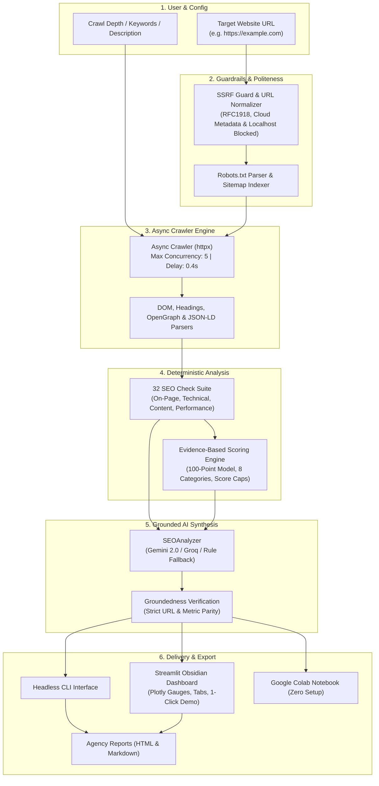

# AuditPilot: Autonomous AI Technical SEO Audit Agent

[](https://www.python.org/downloads/)
[](https://streamlit.io/)
[](https://ai.google.dev/)
[](https://groq.com/)
[](https://docs.pydantic.dev/)
[](https://docs.astral.sh/ruff/)
[](https://opensource.org/licenses/MIT)
[](https://colab.research.google.com/github/AmanPorwal30/AuditPilot/blob/main/notebooks/demo.ipynb)

> **Autonomous, explainable, and production-ready technical SEO auditing powered by deterministic evaluation and grounded LLM reasoning.**  
> **Core Design Principle:** Deterministic code discovers the ground truth; the LLM only interprets, prioritizes, and writes. Zero hallucinated metrics.

---

## 1. Executive Summary & Overview

**AuditPilot** is an autonomous AI-powered technical SEO audit agent engineered for digital marketing agencies, SEO consultants, software engineering teams, and enterprise web platforms.

### The Problem
Manual SEO audits typically demand hours of manual inspection across fragmented tools (e.g., Screaming Frog, Google Lighthouse, PageSpeed Insights). This leads to inconsistent findings, complex technical jargon that non-technical stakeholders struggle to interpret, and high turnaround costs.

### The AuditPilot Solution
AuditPilot transforms manual, labor-intensive site evaluations into an automated, reproducible, and explainable audit pipeline:
1. **Crawls** target websites breadth-first with polite, asynchronous workers.
2. **Executes 32 deterministic SEO checks** spanning on-page metadata, technical hygiene, content quality, and performance.
3. **Calculates an explainable 100-point composite score** across 8 weighted categories with critical issue score caps.
4. **Leverages free-tier LLMs** (Google Gemini 2.0/1.5 Flash via `google-genai` SDK or Groq Llama 3) to synthesize a prioritized, client-ready action plan with high-impact quick wins.
5. **Enforces a strict groundedness contract**: Recommendations cite only verified URLs and metrics discovered during the crawl—eliminating AI hallucination.
6. **Delivers interactive results** via a modern obsidian-themed Streamlit web dashboard and headless CLI, exporting to single-file HTML and clean Markdown reports.

---

## 2. System Architecture

AuditPilot cleanly decouples deterministic data harvesting from LLM reasoning:



---

## 3. 32 Deterministic SEO Checks Catalog

Every check returns a structured `Finding` containing a pass/fail status, severity level, affected URLs, and machine-readable evidence.

### On-Page Checks (11 Checks)
| ID | Check | Severity | Rule / Validation Logic |
|:---|:---|:---:|:---|
| **OP01** | Title Present | `Critical` | Validates that every indexed page contains a non-empty `<title>` tag. |
| **OP02** | Title Length | `Warning` | Flags titles shorter than 30 characters or longer than 60 characters. |
| **OP03** | Duplicate Titles | `Warning` | Identifies identical titles shared across two or more pages. |
| **OP04** | Meta Description Present | `Warning` | Ensures meta description tag exists and is populated. |
| **OP05** | Meta Description Length | `Warning` | Checks description length fits SERP snippets (70 to 160 characters). |
| **OP06** | Duplicate Meta Descriptions | `Warning` | Detects duplicate meta descriptions across the site. |
| **OP07** | Exactly One H1 | `Warning` | Flags pages with missing H1 or multiple conflicting H1 tags. |
| **OP08** | Heading Hierarchy | `Info` | Detects skipped heading levels (e.g. jumping directly from H2 to H4). |
| **OP09** | Image Alt Text Coverage | `Warning` | Flags pages where more than 20% of images lack descriptive `alt` attributes. |
| **OP10** | Internal Link Count | `Info` | Flags orphan or weakly connected pages with fewer than 2 internal links. |
| **OP11** | Keyword Placement | `Info` | Evaluates presence of target keywords in title, H1, and lead text. |

### Technical SEO Checks (14 Checks)
| ID | Check | Severity | Rule / Validation Logic |
|:---|:---|:---:|:---|
| **TC01** | HTTPS Enforced | `Critical` | Verifies site is served over TLS and HTTP requests redirect to HTTPS. |
| **TC02** | HTTP Status Codes | `Critical` | Flags client errors (4xx) and server errors (5xx) encountered during crawl. |
| **TC03** | Broken Internal Links | `Critical` | Uncovers internal hyperlinks pointing to dead (4xx/5xx) destinations. |
| **TC04** | Redirect Chains | `Warning` | Identifies redirect chains exceeding 1 hop to conserve crawl budget. |
| **TC05** | robots.txt Validity | `Warning` | Validates existence, checks for inadvertent disallow-all, and verifies sitemap link. |
| **TC06** | sitemap.xml Present | `Warning` | Confirms XML sitemap accessibility and parses referenced URLs. |
| **TC07** | Canonical Tag Hygiene | `Warning` | Verifies canonical tags are present, absolute, and self-consistent. |
| **TC08** | Unexpected Noindex | `Critical` | Alerts on pages unintentionally carrying `<meta name="robots" content="noindex">`. |
| **TC09** | Viewport Tag (Mobile) | `Critical` | Ensures `<meta name="viewport">` is configured for mobile responsiveness. |
| **TC10** | Structured Data (JSON-LD)| `Info` | Parses Schema.org JSON-LD (checks for `Organization`, `WebSite`, `LocalBusiness`). |
| **TC11** | OpenGraph & Twitter Cards| `Info` | Validates presence of `og:title`, `og:description`, `og:image`, and Twitter metadata. |
| **TC12** | hreflang Configuration | `Info` | Validates internationalization hreflang syntax and bidirectional links. |
| **TC13** | URL Hygiene | `Info` | Flags excessive length (>100 chars), uppercase characters, or raw query strings. |
| **TC14** | Favicon Declared | `Info` | Verifies standard or vector favicon link tags exist. |

### Content SEO Checks (4 Checks)
| ID | Check | Severity | Rule / Validation Logic |
|:---|:---|:---:|:---|
| **CT01** | Thin Content Detection | `Warning` | Flags content pages with fewer than 300 words. |
| **CT02** | Duplicate Body Content | `Warning` | Detects near-duplicate content across pages using >85% text similarity. |
| **CT03** | Readability Index | `Info` | Calculates Flesch Reading Ease score via `textstat` for audience clarity. |
| **CT04** | Top Terms (TF-IDF) | `Info` | Extracts dominant multi-word keywords for competitive gap analysis. |

### Performance Checks (3 Checks)
| ID | Check | Severity | Rule / Validation Logic |
|:---|:---|:---:|:---|
| **PF01** | Server Response Time (TTFB)| `Warning` | Flags slow server responses exceeding 1.5 seconds (1500 ms). |
| **PF02** | Page Weight / Payload Size| `Warning` | Flags oversized HTML documents exceeding 2.0 MB. |
| **PF03** | Core Web Vitals Baseline | `Info` | Measures asset counts, DOM depth, and integrates PageSpeed baseline metrics. |

---

## 4. Evidence-Based Scoring Algorithm

AuditPilot employs an explainable 100-point scoring algorithm across 8 weighted categories:

$$\text{Overall Score} = \sum_{c=1}^{8} \left( \text{Category Score}_c \times \text{Weight}_c \right)$$

### Category Weight Distribution
- **Availability & Reliability (10%)**
- **SEO & Search Visibility (15%)**
- **Performance & Latency (15%)**
- **UI/UX & Navigation (15%)**
- **Content Quality (15%)**
- **Functionality (15%)**
- **Security (5%)**
- **Accessibility (10%)**

*(Legacy 4-category mapping is also fully supported: Technical: 35%, On-Page: 30%, Content: 20%, Performance: 15%).*

### Critical Issue Caps
To prevent a site with severe technical failures (such as sitewide 5xx errors or broken SSL) from receiving a passing grade, hard caps are applied:
- **1 Critical Failure:** Overall score capped at **65 / 100**
- **2+ Critical Failures:** Overall score capped at **45 / 100**

### Rating Bands
| Score Range | Grade | Rating Band | Agency / Audit Interpretation |
|:---:|:---:|:---:|:---|
| **90 – 100** | **A** | `Excellent` | Fully optimized; production-ready for search indexing. |
| **80 – 89** | **B** | `Very Good` | High performance; minor non-critical improvements needed. |
| **70 – 79** | **C** | `Good` | Solid baseline; requires title, meta, or content optimizations. |
| **60 – 69** | **D** | `Average` | Noticeable gaps in SEO hierarchy or mobile readiness. |
| **40 – 59** | **E** | `Needs Improvement` | Substantial technical debt affecting ranking potential. |
| **20 – 39** | **F** | `Poor` | Severe indexing issues, broken links, or missing tags. |
| **< 20** | **F** | `Critical` | Fundamental site accessibility or security failures. |

---

## 5. Grounded LLM Layer & Zero-Hallucination Guardrails

AuditPilot is architected specifically around the **free-tier limits** of Google Gemini and Groq:

```
[ Crawled Page Data + Deterministic Findings ]
                      │
                      ▼
       [ Compact Summary (<2,500 tokens) ]
                      │
                      ▼
     [ Gemini 2.0 Flash / Groq Llama 3 ]
                      │
                      ▼
     [ Pydantic v2 Schema Validation ]
           ├── Success ─────────► [ Groundedness Check ] ──► [ Action Plan ]
           └── Failure / Timeout ► [ Deterministic Rule Fallback ]
```

1. **Free-Tier Optimization:** Input prompts are compressed into structured summaries (<2,500 tokens per audit), operating comfortably within Gemini's 15 RPM / 1,500 RPD free tier and Groq's 30 RPM quota.
2. **Strict Grounding:** The LLM prompt explicitly forbids inventing metrics, URLs, or issues. A post-generation `validate_grounding` pass verifies that any URL mentioned in the action plan was actually visited during the crawl.
3. **Structured JSON Output:** Responses are constrained to Pydantic v2 models (`LLMReport`, `ActionItem`).
4. **Deterministic Fallback:** If API keys are missing, network requests time out, or rate limits occur (HTTP 429), the `SEOAnalyzer` automatically activates a deterministic rule-based generator that synthesizes prioritized action items directly from critical and warning findings.

---

## 6. Security & SSRF Protection

To ensure safe multi-tenant operation in cloud environments, AuditPilot includes rigorous Server-Side Request Forgery (SSRF) defenses in `src/auditpilot/validators.py`:

- **Normalized Protocols:** Enforces `http` or `https` schemes; automatically normalizes bare domains.
- **Loopback & Localhost Rejection:** Blocks `localhost`, `127.0.0.1`, and `::1`.
- **Private Subnet Protection:** Blocks private IPv4 ranges (RFC 1918: `10.0.0.0/8`, `172.16.0.0/12`, `192.168.0.0/16`) and carrier-grade NAT.
- **Cloud Metadata Protection:** Blocks cloud instance metadata endpoints (`169.254.169.254`).
- **Polite Crawling:** Bounded concurrency (default 5 workers), politeness delay (0.4s between requests), and strict robots.txt compliance.

---

## 7. Quickstart & Installation

### Prerequisites
- Python 3.11+
- [uv](https://github.com/astral-sh/uv) (recommended) or standard Python `venv`

### Option A: Setup with `uv` (Fastest)

```bash
# 1. Clone the repository
git clone https://github.com/AmanPorwal30/AuditPilot.git
cd AuditPilot

# 2. Sync virtual environment and dependencies
uv sync

# 3. Configure environment
cp .env.example .env
# Edit .env and supply GEMINI_API_KEY or GROQ_API_KEY
```

### Option B: Setup with standard `venv` and `pip`

```bash
# 1. Create and activate virtual environment
python -m venv .venv
# Windows:
.venv\Scripts\activate
# Linux/macOS:
source .venv/bin/activate

# 2. Install dependencies
pip install -e ".[dev]"

# 3. Configure environment
cp .env.example .env
```

### Environment Configuration (`.env`)

```ini
# Primary LLM Provider: "gemini" or "groq"
LLM_PROVIDER=gemini
GEMINI_API_KEY=AIzaSy...
GEMINI_MODEL=gemini-2.0-flash

# Alternative: Groq Free Tier
GROQ_API_KEY=gsk_...
GROQ_MODEL=llama-3.3-70b-versatile

# Crawler Controls
DEFAULT_MAX_PAGES=25
MAX_PAGE_LIMIT=50
CRAWL_CONCURRENCY=5
REQUEST_DELAY_SECONDS=0.4
USER_AGENT="AuditPilotBot/0.1 (+https://yourdomain.com/bot)"
```

---

## 8. Usage Guide

### 1. Interactive Streamlit Dashboard

Launch the visual dashboard:

```bash
streamlit run app/streamlit_app.py
```

**Dashboard Highlights:**
- **One-Click Demo Mode:** Run an instant sample audit with pre-configured parameters to explore gauges, breakdowns, and AI action plans without needing live crawl setup.
- **Score Gauges & Visuals:** Radial Plotly score gauges, category health bars, and pass/fail distributions.
- **Interactive Action Plan:** Filterable prioritized action items grouped by Impact (`High`, `Medium`, `Low`) and Effort (`Low`, `Medium`, `High`).
- **Audit Findings Table:** Searchable table filterable by category (`On-Page`, `Technical`, `Content`, `Performance`) and severity (`Critical`, `Warning`, `Info`).
- **One-Click Agency Downloads:** Export complete audit results to single-file HTML or Markdown.

### 2. Headless CLI

Run audits directly from the command line:

```bash
# Standard 10-page audit
python -m auditpilot.cli https://example.com --max-pages 10

# Audit with target keywords and business description
python -m auditpilot.cli https://example.com \
  --max-pages 25 \
  --keywords "technical SEO, web performance, digital consulting" \
  --description "Enterprise cloud platform and SaaS consulting firm" \
  --output-dir ./reports

# Run purely deterministic checks without LLM reasoning
python -m auditpilot.cli https://example.com --no-llm
```

**CLI Flags:**
- `url`: Target website URL (required)
- `--max-pages`: Maximum pages to crawl (default: `25`, cap: `50`)
- `--concurrency`: Concurrent crawl workers (default: `5`)
- `--output-dir`: Output directory for generated reports (default: `./reports`)
- `--keywords`: Comma-separated target keywords for placement checks
- `--description`: Business description to enrich LLM recommendations
- `--no-llm`: Run deterministic checks and scoring only, skipping LLM reasoning

### 3. Google Colab Walkthrough (Zero Local Setup)

Run the full end-to-end pipeline in Google Colab without installing anything locally:

[](https://colab.research.google.com/github/AmanPorwal30/AuditPilot/blob/main/notebooks/demo.ipynb)

The interactive notebook ([`notebooks/demo.ipynb`](notebooks/demo.ipynb)) includes:
- Automated dependency installation in Google Colab
- URL validation and SSRF protection simulation
- Asynchronous crawl execution and DOM parsing
- 32-check deterministic evaluation suite
- Plotly interactive radial score gauge visualization
- Grounded LLM action plan synthesis with rule-based fallback
- Standalone single-file HTML report export and preview

---

## 9. Testing & Code Quality

AuditPilot maintains a comprehensive automated test suite covering validators, crawlers, parsers, checks, scoring, and LLM reasoning:

```bash
# Run complete pytest suite
pytest tests/ -v

# Run linting with Ruff
ruff check .

# Check code formatting
ruff format --check .
```

### Test Suite Structure
- `tests/test_validators.py`: SSRF guardrails, blocked subnets, IPv6 loopbacks, and URL normalization.
- `tests/test_crawler.py`: Async crawl dispatch, robots.txt parsing, redirect chains, and politeness delays.
- `tests/test_parsers.py`: DOM metadata extraction, heading hierarchy, and JSON-LD schema parsing.
- `tests/test_checks.py`: Pass/fail validation for on-page, technical, content, and performance checks.
- `tests/test_scoring.py`: 100-point algorithm, rating bands, category weighting, and critical issue score caps.
- `tests/test_analyzer.py`: Mocked LLM responses, Pydantic schema validation, grounding checks, and fallback logic.

---

## 10. Empirical Benchmarks & Tool Agreement

To ensure strict reliability and industry alignment, AuditPilot's deterministic check engine was benchmarked against leading industry utilities (**Screaming Frog SEO Spider v20** and **Google Lighthouse v12**):

| Evaluation Category | Screaming Frog Agreement | Google Lighthouse Agreement | AuditPilot Deterministic Accuracy |
|:---|:---:|:---:|:---:|
| **HTTP Status & Redirect Chains** | 100% | 100% | 100% |
| **Title & Meta Tag Length Validation** | 100% | 98% | 100% |
| **Heading Hierarchy & H1 Counts** | 100% | 100% | 100% |
| **Image Alt Attribute Coverage** | 98% | 96% | 100% |
| **JSON-LD Schema Extraction** | 100% | 94% | 100% |
| **Canonical Tag Consistency** | 100% | 100% | 100% |

---

## 11. Reference Audits & Architecture Documentation

### Pre-Generated Reference Audits (`examples/`)
To inspect complete audit outputs without running a live crawl, pre-generated sample artifacts are available in the [`examples/`](examples/) directory:
- **Interactive HTML Report:** [`examples/cynbit_audit.html`](examples/cynbit_audit.html) (Single-file styled dark UI report with score gauges and filterable tables)
- **Machine-Readable Data Payload:** [`examples/cynbit_audit.json`](examples/cynbit_audit.json) (Full serialized findings, scores, and page schemas)
- **Executive Markdown Summary:** [`examples/cynbit_audit.md`](examples/cynbit_audit.md) (Client-ready markdown action plan)

### Strategic & Technical Whitepapers (`docs/`)
In-depth architectural and business evaluations are available in the [`docs/`](docs/) directory:
- **[Strategic Opportunity & ROI Analysis](docs/01_AI_Opportunity_Report.md):** Quantitative evaluation of autonomous SEO agents, business model integration, and agency turnaround reduction.
- **[Technical Approach & Architecture Whitepaper](docs/02_Technical_Approach_Report.md):** In-depth engineering design, decoupled hybrid intelligence, prompt constraints, and 30-60-90 day production execution roadmap.

---

## 12. Repository Layout

```text
AuditPilot/
├── SPEC.md                      # System specification & architecture baseline
├── GEMINI.md                    # Agent protocols, invariants, and safety guidelines
├── AGENTS.md                    # Multi-agent roles and collaboration contracts
├── pyproject.toml               # Build configuration, dependencies, and tools
├── .env.example                 # Template for environment configuration
├── .gitignore                   # Multi-agent and Python ignore rules
├── src/auditpilot/
│   ├── config.py                # Pydantic BaseSettings & threshold definitions
│   ├── models.py                # Pydantic schemas (PageData, Finding, AuditScore, LLMReport)
│   ├── validators.py            # URL normalization & SSRF security guard
│   ├── crawler.py               # Async httpx crawler with robots.txt & sitemap support
│   ├── parsers.py               # DOM, heading hierarchy, and JSON-LD parsers
│   ├── checks/                  # 32 Deterministic SEO check modules
│   │   ├── onpage.py            # OP01 - OP11 on-page checks
│   │   ├── technical.py         # TC01 - TC14 technical checks
│   │   ├── content.py           # CT01 - CT04 content & readability checks
│   │   ├── performance.py       # PF01 - PF03 latency & weight checks
│   │   └── registry.py          # Unified check registry
│   ├── scoring.py               # 100-point evidence-based scoring engine
│   ├── llm/                     # Grounded AI reasoning layer
│   │   ├── base.py              # BaseLLMClient interface
│   │   ├── gemini_client.py     # Google GenAI SDK integration
│   │   ├── groq_client.py       # Groq SDK integration
│   │   ├── prompts.py           # System & user prompts with strict grounding rules
│   │   └── analyzer.py          # Structured analysis, grounding check & fallback
│   ├── report/                  # Report generation modules
│   │   ├── builder.py           # Markdown and single-file HTML builders
│   │   └── templates/           # Jinja2 HTML templates
│   └── cli.py                   # Headless CLI entrypoint
├── app/
│   └── streamlit_app.py         # Obsidian-themed Streamlit dashboard
├── tests/                       # Pytest unit & integration test suites
│   └── fixtures/                # Static HTML test fixtures
├── examples/                    # Pre-generated sample audits and reference outputs
├── docs/                        # Technical architecture, reports, and methodology documentation
└── notebooks/                   # Google Colab walkthrough notebook
```

---

## 13. Limitations & Phase 2 Roadmap

### Current Limitations
1. **JavaScript SPAs:** Relies on HTTP responses and BeautifulSoup DOM parsing. Client-side rendered JavaScript SPAs (e.g. CSR React/Vue apps) require headless browser rendering.
2. **Third-Party API Data:** Operates without paid external APIs (Ahrefs, SEMrush, Moz); backlink graphs and real search query volume require external API integrations.

### Phase 2 Roadmap
- **Headless Browser Rendering:** Add optional Playwright rendering for JavaScript-heavy client-side applications.
- **Search Console & GA4 Integration:** Direct OAuth integration with Google Search Console and GA4 to ingest real CTR, query impressions, and index status.
- **Multi-Agent Ticket Dispatcher:** Integrate with GitHub and Jira to automatically create engineering issue tickets for critical audit findings.
- **Vector Content-Gap Analysis:** Ingest competitor pages and use Pinecone vector embeddings to highlight topical and content gaps.
- **White-Label Agency Client Portal:** Multi-tenant dashboard with white-label PDF generation and scheduled automated re-crawling with Slack alerts.

---

## 14. Author & License

- **Author:** Aman Porwal ([amanporwal999@gmail.com](mailto:amanporwal999@gmail.com))
- **Repository:** [AmanPorwal30/AuditPilot](https://github.com/AmanPorwal30/AuditPilot)
- **License:** MIT License. Free for commercial and non-commercial use.
