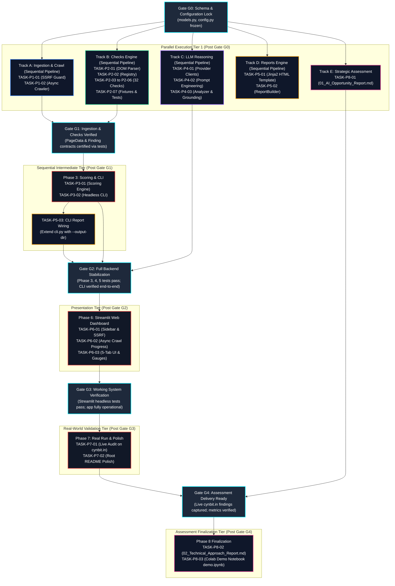
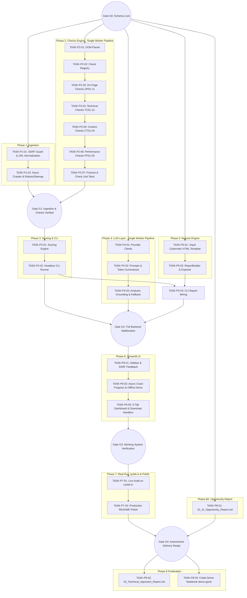

# AuditPilot: Master Multi-Phase Execution Plan & Dependency-Mapped Task Catalog
**Project:** AuditPilot Autonomous Technical SEO Audit Platform  
**Organization:** Cynbit Technologies Private Limited  
**Target File:** `E:\Cynbit Project\TODO.md`  
**Guiding Principle:** Boil the Lake (Complete implementation, 100% test coverage, zero shortcuts)  
**Document Version:** 1.0.0 (Production Roadmap)  
**Last Updated:** 2026-10-30  

---

## 1. Master Execution Architecture

### 1.1 High-Level Progress Tracker Across Phases 1 through 8

| Phase | Milestone Name | Track | Gate Dependency | Primary Output Files | Status |
|---|---|---|---|---|:---:|
| **Phase 0** | Scaffold & Configuration | Sequential | Prerequisite | `models.py`, `config.py`, `pyproject.toml` | **COMPLETED** |
| **Phase 1** | Models, SSRF Guard & Async Crawler | Track A | Gate G0 | `validators.py`, `crawler.py` | **READY** |
| **Phase 2** | Parsers & 27 SEO Checks Engine (32 Total) | Track B | Gate G0 | `parsers.py`, `checks/*.py`, fixtures | **READY** |
| **Phase 3** | Scoring Engine & Headless CLI | Sequential | Gate G1 (M1 + M2) | `scoring.py`, `cli.py` | **PLANNED** |
| **Phase 4** | LLM Reasoning & Grounding Layer | Track C | Gate G0 (Mocked) / Gate G1 | `llm/*.py`, `test_analyzer.py` | **READY** |
| **Phase 5** | Reports Engine (Jinja2 HTML & Markdown) | Track D | Gate G0 (Mocked) / Gate G1 | `report/builder.py`, `report.html.j2` | **READY** |
| **Phase 6** | Streamlit Web Application | Sequential | Gate G2 (M3 + M4 + M5) | `app/streamlit_app.py` | **PLANNED** |
| **Phase 7** | Real Run on cynbit.in & Root Polish | Sequential | Gate G3 (M6) | `examples/*`, `README.md` | **PLANNED** |
| **Phase 8** | Assessment Deliverables & Colab Notebook | Track E / Seq | Gate G0 (8A) / Gate G4 (8B, 8C) | `docs/*.md`, `notebooks/demo.ipynb` | **READY / PLANNED** |

---

### 1.2 Visual Mermaid Workflow: Sequential Gates & Parallelizable Tracks

> **Two-Tier Concurrency Architecture (Rule 8):**  
> - **Horizontal Concurrency (Parallel Tracks):** Post-Gate G0, Tracks A, B, C, D, and E execute concurrently in parallel across disjoint, non-overlapping file sets.  
> - **Vertical Concurrency (Sequential Pipelines):** Within each track, subtasks execute sequentially in pipeline order by a single assigned worker agent, guaranteeing zero write contention on shared test files (`tests/test_checks.py`, `tests/test_analyzer.py`).



---

## 2. Collision Prevention & Concurrency Rules

### 2.1 Comprehensive Matrix of Touched Files Across All 8 Phases

The table below governs exact file access permissions across all phases. Concurrent tasks are strictly forbidden from writing to the same file.

| File / Directory Path | Phase 0 | Phase 1 | Phase 2 | Phase 3 | Phase 4 | Phase 5 | Phase 6 | Phase 7 | Phase 8 | Ownership & Mutation Lifecycle |
|---|:---:|:---:|:---:|:---:|:---:|:---:|:---:|:---:|:---:|---|
| `pyproject.toml` | **W** | R | R | R | R | R | R | R | R | Scaffold (Locked) |
| `src/auditpilot/models.py` | **W** | R | R | R | R | R | R | R | R | Immutable Schemas (**Gate G0**) |
| `src/auditpilot/config.py` | **W** | R | R | R | R | R | R | R | R | Immutable Configuration (**Gate G0**) |
| `src/auditpilot/validators.py` | S | **W** | - | R | - | - | R | R | - | **Track A Exclusive** |
| `src/auditpilot/crawler.py` | S | **W** | - | R | - | - | R | R | - | **Track A Exclusive** |
| `src/auditpilot/parsers.py` | S | - | **W** | R | - | - | R | R | - | **Track B Exclusive** |
| `src/auditpilot/checks/registry.py` | S | - | **W** | R | - | - | R | R | - | **Track B Exclusive** |
| `src/auditpilot/checks/onpage.py` | S | - | **W** | R | - | - | R | R | - | **Track B Exclusive** |
| `src/auditpilot/checks/technical.py` | S | - | **W** | R | - | - | R | R | - | **Track B Exclusive** |
| `src/auditpilot/checks/content.py` | S | - | **W** | R | - | - | R | R | - | **Track B Exclusive** |
| `src/auditpilot/checks/performance.py`| S | - | **W** | R | - | - | R | R | - | **Track B Exclusive** |
| `src/auditpilot/scoring.py` | S | - | - | **W** | - | R | R | R | - | **Phase 3 Exclusive** |
| `src/auditpilot/cli.py` | S | - | - | **W** | - | **M** | - | R | - | **Phase 3 Author; Phase 5 Extends** |
| `src/auditpilot/llm/base.py` | S | - | - | - | **W** | R | R | R | - | **Track C Exclusive** |
| `src/auditpilot/llm/gemini_client.py` | S | - | - | - | **W** | - | R | R | - | **Track C Exclusive** |
| `src/auditpilot/llm/groq_client.py` | S | - | - | - | **W** | - | R | R | - | **Track C Exclusive** |
| `src/auditpilot/llm/prompts.py` | S | - | - | - | **W** | - | R | R | - | **Track C Exclusive** |
| `src/auditpilot/llm/analyzer.py` | S | - | - | - | **W** | R | R | R | - | **Track C Exclusive** |
| `src/auditpilot/report/builder.py` | S | - | - | - | - | **W** | R | R | - | **Track D Exclusive** |
| `src/auditpilot/report/templates/*.j2` | S | - | - | - | - | **W** | - | R | - | **Track D Exclusive** |
| `app/streamlit_app.py` | S | - | - | - | - | - | **W** | R | - | **Phase 6 Exclusive** |
| `examples/cynbit_audit.*` | - | - | - | - | - | - | - | **W** | R | **Phase 7 Exclusive** |
| `README.md` | S | - | - | - | - | - | - | **W** | R | **Phase 7 Exclusive** |
| `docs/01_AI_Opportunity_Report.md` | - | - | - | - | - | - | - | - | **W** | **Track E Exclusive** |
| `docs/02_Technical_Approach_Report.md`| - | - | - | - | - | - | - | - | **W** | **Phase 8 Exclusive** |
| `docs/architecture.png` | - | - | - | - | - | - | - | - | **W** | **Phase 8 Exclusive** |
| `notebooks/demo.ipynb` | - | - | - | - | - | - | - | - | **W** | **Phase 8 Exclusive** |
| `tests/test_validators.py` | S | **W** | - | - | - | - | - | - | - | **Track A Exclusive** |
| `tests/test_crawler.py` | - | **W** | - | - | - | - | - | - | - | **Track A Exclusive** |
| `tests/test_checks.py` | S | - | **W** | - | - | - | - | - | - | **Track B Exclusive** |
| `tests/test_parsers.py` | - | - | **W** | - | - | - | - | - | - | **Track B Exclusive** |
| `tests/fixtures/*.html` | - | - | **W** | - | - | - | - | - | - | **Track B Exclusive** |
| `tests/test_scoring.py` | S | - | - | **W** | - | - | - | - | - | **Phase 3 Exclusive** |
| `tests/test_cli.py` | - | - | - | **W** | - | **M** | - | - | - | **Phase 3 Author; Phase 5 Extends** |
| `tests/test_analyzer.py` | S | - | - | - | **W** | - | - | - | - | **Track C Exclusive** |
| `tests/test_reports.py` | - | - | - | - | - | **W** | - | - | - | **Track D Exclusive** |
| `tests/test_streamlit_app.py` | - | - | - | - | - | - | **W** | - | - | **Phase 6 Exclusive** |

*Legend:*  
- **W**: Primary Authoring / File Creation  
- **M**: Sequential Modification / Extension (Strictly after authoring phase is closed)  
- **R**: Read-Only Dependency  
- **S**: Initial Phase 0 Stub  
- **-**: Unrelated / Out of Scope  

---

### 2.2 Strict File Ownership & Concurrency Bound Rules

1. **Rule 1 — Absolute Single File Ownership:**  
   Every file in the repository has exactly one primary authoring phase. No two tasks executing concurrently may write to the same file.
2. **Rule 2 — Sequential Handover for Shared CLI (`cli.py`):**  
   `src/auditpilot/cli.py` and `tests/test_cli.py` are authored and owned by Phase 3 (`TASK-P3-02`). Phase 5 (`TASK-P5-03`) extends `cli.py` with `--output-dir` and report building *only* after Phase 3 is committed and certified under Gate G1.
3. **Rule 3 — Interface Stub Isolation & Test Decoupling:**  
   - Track A (`crawler.py`) communicates with Track B (`parsers.py`) through the functional contract `parse_page_html(url: str, html: str, status_code: int = 200) -> PageData`. Track A tests using mock HTML fixtures without needing Track B check implementations.
   - Track B tests with static fixture files in `tests/fixtures/` without needing network or crawler infrastructure.
4. **Rule 4 — Mock Boundaries for External APIs (LLM & PageSpeed):**  
   - Track C (`llm/`) tests in `tests/test_analyzer.py` must use a synthetic `MockLLMClient` returning valid Pydantic JSON. Zero live API calls are permitted during automated test runs.
   - Performance check `PF03` must mock or gracefully skip the Google PageSpeed Insights API if `PAGESPEED_API_KEY` is not present in `.env`.
5. **Rule 5 — Synthetic Test Data for Reports:**  
   Track D (`report/`) tests HTML and Markdown rendering using an in-memory synthetic `AuditResult` fixture containing sample findings and scores. It has zero runtime dependency on live crawler or LLM operations.
6. **Rule 6 — Root README Exclusivity:**  
   `README.md` is authored and polished exclusively by Phase 7 (`TASK-P7-02`). Intermediate phases record technical metadata inside `.agents/teamwork/` and do not touch `README.md`.
7. **Rule 7 — Strategic Assessment Document Independence:**  
   `docs/01_AI_Opportunity_Report.md` (Track E) has zero code dependencies and may be authored immediately upon Gate G0. `docs/02_Technical_Approach_Report.md` and `notebooks/demo.ipynb` are finalized in Phase 8 after Phase 7 records real-world audit telemetry on `cynbit.in`.
8. **Rule 8 — Intra-Track Sequential Pipeline & Single-Worker Ownership (Two-Tier Concurrency Architecture):**  
   - **Cross-Track Parallelism (Macro Concurrency):** Post-Gate G0, **Tracks A, B, C, D, and E (Phase 8A) execute in parallel with each other**. Each track operates on a 100% mutually exclusive, disjoint file footprint across all source files, unit tests, templates, and documentation (as mapped in Section 2.1). An orchestrator may safely dispatch concurrent subagents to Track A, Track B, Track C, Track D, and Track E simultaneously without file collisions or merge contention.
   - **Intra-Track Sequentiality (Micro Concurrency / Single-Worker Ownership):** Subtasks *within* an individual track must be owned and executed **sequentially in pipeline order by a single assigned worker agent**.
     - **Track B (`TASK-P2-01` through `TASK-P2-07`):** Assigned exclusively to a single worker agent (e.g. `@backend`). The worker executes tasks in strict linear sequence: `TASK-P2-01` (DOM parser) $\to$ `TASK-P2-02` (Check registry) $\to$ `TASK-P2-03` (OP01-11) $\to$ `TASK-P2-04` (TC01-14) $\to$ `TASK-P2-05` (CT01-04) $\to$ `TASK-P2-06` (PF01-03) $\to$ `TASK-P2-07` (Fixtures & comprehensive tests).  
       *Collision Prevention:* Because `tests/test_checks.py` and `src/auditpilot/checks/registry.py` are shared across all check implementations, running check subtasks in parallel would trigger fatal write-write collisions. Single-worker ownership guarantees that the Track B worker incrementally authors check modules and appends test cases to `tests/test_checks.py` without race conditions.
     - **Track C (`TASK-P4-01` through `TASK-P4-03`):** Assigned exclusively to a single worker agent (e.g. `@aiml`). The worker executes tasks in strict linear sequence: `TASK-P4-01` (Provider clients: Base, Gemini, Groq) $\to$ `TASK-P4-02` (Prompt engineering & token summarizer) $\to$ `TASK-P4-03` (Analyzer, cache, grounding & fallback).  
       *Collision Prevention:* Both `P4-01` and `P4-02` feed into `tests/test_analyzer.py` and `src/auditpilot/llm/analyzer.py`. Single-worker sequential execution guarantees zero file contention on `tests/test_analyzer.py`.
     - **Track A (`TASK-P1-01` $\to$ `TASK-P1-02`):** Assigned to a single worker; `P1-02` (crawler) sequentially consumes `P1-01` (`validators.py`).
     - **Track D (`TASK-P5-01` $\to$ `TASK-P5-02`):** Assigned to a single worker; `P5-02` (`builder.py`) sequentially consumes `P5-01` (`report.html.j2`).
     - **Track E (`TASK-P8-01`):** Assigned to a single worker (e.g. `@architect`).
   - **Orchestration Invariant:** Multi-agent orchestrators MUST NOT spawn parallel subagents for subtasks within Track B or Track C. Concurrency is strictly horizontal across tracks (Track A || Track B || Track C || Track D || Track E), never vertical within a shared-file track.
   - **Interim Verification Protocol:** Subtasks prior to the comprehensive test authoring step (`TASK-P2-03..P2-06`, `TASK-P4-01..P4-02`, `TASK-P5-01`) verify completion via clean Python module import, callable validation, template syntax checks, and `ruff` lint checks (`python -c "from ... import ..."` and `ruff check`), avoiding premature pytest filter runs (`pytest -k <filter>`) that exit with code 1 against uninstantiated test files. Full pytest test runs are reserved exclusively for `TASK-P2-07`, `TASK-P4-03`, `TASK-P5-02`, and Milestone Gates (`Gate G1`, `Gate G2`, `Gate G3`, `Gate G4`).

---

## 3. Phase Gate Definitions & Verification Criteria

### Gate G0: Schema & Configuration Lock
- **Objective:** Freeze foundational data contracts and configuration models to allow 5 parallel execution tracks without schema drift.
- **Criteria:**
  1. `src/auditpilot/models.py` defines `PageData`, `Finding`, `ActionItem`, `LLMReport`, `CategoryScore`, `AuditScore`, and `AuditResult` with strict type annotations.
  2. `src/auditpilot/config.py` defines `Settings` via `pydantic-settings` (loading `LLM_PROVIDER`, `GEMINI_API_KEY`, `GEMINI_MODEL`, `GROQ_API_KEY`, etc.).
  3. `ruff check src/auditpilot/models.py src/auditpilot/config.py` passes with zero violations.
- **Verification Command:**
  ```powershell
  uv run ruff check src/auditpilot/models.py src/auditpilot/config.py
  uv run python -c "from auditpilot.models import PageData, Finding, AuditScore, LLMReport; from auditpilot.config import settings; print('Gate G0 PASSED')"
  ```

---

### Gate G1: Ingestion & Checks Verified
- **Objective:** Certify deterministic crawling, DOM parsing, and all 32 SEO checks before building the scoring engine.
- **Criteria:**
  1. Phase 1 crawler (`crawler.py`) and validator (`validators.py`) pass all unit tests.
  2. SSRF guard rejects loopback, RFC 1918 private subnets, link-local, multicast, and cloud metadata (`169.254.169.254`).
  3. Phase 2 parser (`parsers.py`) accurately decomposes DOM elements and visible text.
  4. All 32 check IDs (OP01-11, TC01-14, CT01-04, PF01-03) execute via `CheckRegistry.run_all()` and return valid `Finding` models.
- **Verification Command:**
  ```powershell
  uv run pytest tests/test_validators.py tests/test_crawler.py tests/test_parsers.py tests/test_checks.py -v
  uv run ruff check src/auditpilot/validators.py src/auditpilot/crawler.py src/auditpilot/parsers.py src/auditpilot/checks
  ```

---

### Gate G2: Full Backend Stabilization
- **Objective:** Certify that deterministic scoring, LLM synthesis with fallback, and HTML/MD report generation are fully operational in headless CLI mode.
- **Criteria:**
  1. Phase 3 scoring engine correctly computes category deductions, proportional page scaling, weighted totals, and letter grades (A-F).
  2. Phase 4 LLM analyzer validates structured output, retries once on schema error, strips un-crawled URLs via groundedness checking, and triggers deterministic fallback on failure.
  3. Phase 5 report builder exports complete single-file obsidian dark HTML and clean Markdown reports.
  4. Headless CLI execution (`python -m auditpilot.cli --no-llm`) runs to completion with exit code 0.
- **Verification Command:**
  ```powershell
  uv run pytest tests/test_scoring.py tests/test_cli.py tests/test_analyzer.py tests/test_reports.py -v
  uv run python -m auditpilot.cli https://example.com --max-pages 2 --no-llm --output-dir ./reports
  ```

---

### Gate G3: Working System Verification
- **Objective:** Certify that the Streamlit web dashboard is fully functional, responsive, and handles live crawls as well as offline demo audits.
- **Criteria:**
  1. Streamlit app runs headlessly without exceptions via `streamlit.testing.v1.AppTest`.
  2. Sidebar inputs and instant SSRF guard warnings function correctly.
  3. "⚡ Audit cynbit.in" demo button triggers crawl or loads offline sample report when API keys are absent.
  4. Plotly semicircular gauge and category bar charts render without NaN errors.
  5. Findings filterable dataframe and report download buttons operate cleanly.
- **Verification Command:**
  ```powershell
  uv run pytest tests/test_streamlit_app.py -v
  uv run python -c "from streamlit.testing.v1 import AppTest; at = AppTest.from_file('app/streamlit_app.py').run(); assert not at.exception, 'Streamlit initialization failed'; print('Gate G3 PASSED')"
  uv run ruff check app/
  ```

---

### Gate G4: Assessment Delivery Ready
- **Objective:** Certify that a real crawl on `https://cynbit.in` has been successfully executed, sample reports are saved in `examples/`, and root README polish is complete.
- **Criteria:**
  1. `examples/cynbit_audit.html`, `examples/cynbit_audit.md`, and `examples/cynbit_audit.json` exist, are non-empty, and contain real findings (e.g. OP02 title length warning, OP05 description length warning).
  2. Root `README.md` contains badges, quickstart, architecture flowchart, check catalog, scoring formula, and roadmap.
  3. Ready to finalize `docs/02_Technical_Approach_Report.md` and `notebooks/demo.ipynb`.
- **Verification Command:**
  ```powershell
  uv run python -c "from pathlib import Path; assert (Path('examples/cynbit_audit.html').stat().st_size > 1000); assert (Path('examples/cynbit_audit.md').stat().st_size > 500); assert (Path('examples/cynbit_audit.json').stat().st_size > 1000); print('Gate G4 PASSED')"
  ```

---

## 4. Detailed Discrete Tasks: Phase 1 through Phase 8

---

### Phase 1: Models, SSRF Guard, and Async Crawler

#### TASK-P1-01: URL Normalization & SSRF Defense Guard
- **Track & Concurrency:** Track A (Parallel with Tracks B, C, D, E; Sequential within Track A pipeline - Single Worker)
- **Prerequisites:** Gate G0 (`models.py`, `config.py` locked)
- **Touched Files:**
  - *Input Files:* `src/auditpilot/config.py`
  - *Modified/Created Files:* `src/auditpilot/validators.py`
  - *Test Files:* `tests/test_validators.py`
- **Technical Specification:**
  - Implement `normalize_url(url: str) -> str`:
    - Strip whitespace, prepend `https://` if scheme is absent.
    - Validate scheme: strictly `http` or `https`; raise `ValueError` on any other scheme (e.g. `ftp:`, `file:`, `javascript:`, `data:`).
    - Parse using `urllib.parse.urlsplit`; lowercase hostname; strip default ports (`:80` for http, `:443` for https).
    - Remove URL fragments (`#...`); normalize empty path to `/`.
  - Implement `is_safe_url(url: str) -> tuple[bool, str]`:
    - Check hostname against literal blacklists: `localhost`, `*.localhost`, `0.0.0.0`, `127.0.0.1`, `::1`.
    - Check hostname against cloud metadata services: `169.254.169.254`, `metadata.google.internal`, `100.100.100.200`.
    - Perform DNS resolution using `socket.getaddrinfo(hostname, None)`.
    - For every resolved IP address, parse with `ipaddress.ip_address()`:
      - Reject if `ip.is_private` (RFC 1918: `10.0.0.0/8`, `172.16.0.0/12`, `192.168.0.0/16`; RFC 4193: `fc00::/7`).
      - Reject if `ip.is_loopback` (`127.0.0.0/8`, `::1`).
      - Reject if `ip.is_link_local` (`169.254.0.0/16`, `fe80::/10`).
      - Reject if `ip.is_multicast` (`224.0.0.0/4`, `ff00::/8`).
      - Reject if `ip.is_reserved` or `ip.is_unspecified`.
    - Handle `socket.gaierror` safely; return `(False, "Could not resolve hostname")`.
    - Return `(True, "OK")` when all resolved addresses are strictly public routable IPs.
- **Verification Mechanism:**
  ```powershell
  uv run pytest tests/test_validators.py -v
  uv run ruff check src/auditpilot/validators.py
  ```

---

#### TASK-P1-02: Asynchronous Polite BFS Crawler & Robot/Sitemap Engine
- **Track & Concurrency:** Track A (Parallel with Tracks B, C, D, E; Sequential within Track A pipeline - Single Worker)
- **Prerequisites:** TASK-P1-01
- **Touched Files:**
  - *Input Files:* `src/auditpilot/validators.py`, `src/auditpilot/models.py`
  - *Modified/Created Files:* `src/auditpilot/crawler.py`
  - *Test Files:* `tests/test_crawler.py`
- **Technical Specification:**
  - Implement `class AsyncCrawler`:
    - `__init__(self, base_url: str, max_pages: int = 25, concurrency: int = 5, delay_seconds: float = 0.4, timeout_seconds: float = 10.0, user_agent: str | None = None)`:
      - Cap `max_pages` at `min(max_pages, 50)`.
      - Set User-Agent to `AuditPilotBot/0.1 (+https://cynbit.in/bot)`.
      - Extract registered domain using `tldextract.extract(base_url).registered_domain`.
    - `crawl(self) -> AsyncGenerator[PageData, None]`:
      - Queue-based BFS traversal initialized with `base_url`.
      - Enforce concurrency via `asyncio.Semaphore(concurrency)`.
      - Enforce politeness delay: `await asyncio.sleep(delay_seconds)`.
      - Use `httpx.AsyncClient(timeout=timeout_seconds, follow_redirects=True)`.
      - Startup/Pre-flight step:
        - Fetch `/robots.txt`; parse with `urllib.robotparser.RobotFileParser`; extract `Sitemap:` directives.
        - Fetch `/sitemap.xml`; parse XML urlset or sitemap index; seed discovered internal URLs to BFS queue.
      - Worker loop:
        - Verify `robot_parser.can_fetch(user_agent, url)`; skip if disallowed.
        - Inspect HTTP response headers: skip non-HTML `Content-Type` (e.g. `application/pdf`, `image/*`).
        - Track `response.status_code`, `response.history` (redirect chain), elapsed time in ms (`response.elapsed.total_seconds() * 1000`), and `len(response.content)`.
        - Parse page into `PageData` using `parse_page_html`.
        - Enqueue unvisited links matching registered domain.
        - Yield `PageData` incrementally.
        - Retry once on transient network timeout or connection reset.
- **Verification Mechanism:**
  ```powershell
  uv run pytest tests/test_crawler.py -v
  uv run ruff check src/auditpilot/crawler.py
  ```

---

### Phase 2: Parsers and 27 Core SEO Checks Engine (Full 32 Check Catalog)

#### TASK-P2-01: HTML DOM Decomposition & Content Extraction Parser
- **Track & Concurrency:** Track B (Parallel with Tracks A, C, D, E; Sequential within Track B pipeline - Single Worker)
- **Prerequisites:** Gate G0 (`models.py` locked)
- **Touched Files:**
  - *Input Files:* `src/auditpilot/models.py`
  - *Modified/Created Files:* `src/auditpilot/parsers.py`
  - *Test Files:* `tests/test_parsers.py`, `tests/fixtures/sample_page.html`
- **Technical Specification:**
  - Implement `parse_page_html(url: str, html: str, status_code: int = 200, response_time_ms: float = 0.0, redirect_chain: list[str] | None = None) -> PageData`:
    - Parse HTML using `BeautifulSoup(html, "lxml")`.
    - Extract `<title>` (stripped or `None`).
    - Extract `<meta name="description" content="...">` (stripped or `None`).
    - Extract all `<h1>` tags into `h1s: list[str]`.
    - Extract all headings `<h1>` to `<h6>` into `headings: list[tuple[int, str]]` in document appearance order.
    - Compute visible `word_count`:
      - Decompose non-content tags: `<script>`, `<style>`, `<nav>`, `<footer>`, `<header>`, `<noscript>`, `<svg>`.
      - Extract visible text, normalize whitespace, split words.
    - Image analysis:
      - Count total `` tags (`images_total`).
      - Count `` tags missing `alt` or with whitespace-only `alt` (`images_missing_alt`).
    - Link extraction & classification:
      - Extract `<a href="...">`; resolve relative URLs with `urllib.parse.urljoin(url, href)`; strip fragments.
      - Classify into `internal_links` (matching `tldextract` registered domain) and `external_links`.
    - Technical tags:
      - Canonical: `<link rel="canonical" href="...">`.
      - Meta robots: `<meta name="robots" content="...">`.
      - JSON-LD: Parse `<script type="application/ld+json">`; extract `@type` entities (supporting single objects and `@graph` arrays).
      - Top terms: Extract high-frequency keywords using simple term frequency or TF-IDF tokens.
- **Verification Mechanism:**
  ```powershell
  uv run pytest tests/test_parsers.py -v
  uv run ruff check src/auditpilot/parsers.py
  ```

---

#### TASK-P2-02: Pluggable Check Registry Architecture
- **Track & Concurrency:** Track B (Parallel with Tracks A, C, D, E; Sequential within Track B pipeline - Single Worker)
- **Prerequisites:** TASK-P2-01
- **Touched Files:**
  - *Input Files:* `src/auditpilot/models.py`
  - *Modified/Created Files:* `src/auditpilot/checks/registry.py`
  - *Test Files:* `tests/test_checks.py`
- **Technical Specification:**
  - Implement `class CheckRegistry`:
    - Internal registry: `_checks: list[Callable[[list[PageData]], list[Finding]]]`.
    - Method `register(self, func: Callable)`: Decorator registering check functions.
    - Method `run_all(self, pages: list[PageData], **kwargs) -> list[Finding]`:
      - Executes all registered checks safely.
      - Aggregates returned `Finding` lists.
      - Logs warnings if an individual check raises an unhandled exception, ensuring fault tolerance.
    - Create singleton instance: `registry = CheckRegistry()`.
- **Verification Mechanism:**
  ```powershell
  uv run pytest tests/test_checks.py -k "test_registry" -v
  uv run ruff check src/auditpilot/checks/registry.py
  ```

---

#### TASK-P2-03: On-Page SEO Checks Implementation (OP01 through OP11)
- **Track & Concurrency:** Track B (Parallel with Tracks A, C, D, E; Sequential within Track B pipeline - Single Worker)
- **Prerequisites:** TASK-P2-02
- **Touched Files:**
  - *Input Files:* `src/auditpilot/models.py`, `src/auditpilot/checks/registry.py`
  - *Modified/Created Files:* `src/auditpilot/checks/onpage.py`
  - *Test Files:* `tests/test_checks.py`
- **Technical Specification:**
  Register and implement all 11 On-Page checks returning `list[Finding]`:
  1. `OP01` — **Title present:** Severity: `critical`. Rule: Page `<title>` must exist and be non-empty. Fails if missing or empty.
  2. `OP02` — **Title length:** Severity: `warning`. Rule: Title length must be between 30 and 60 characters. Fails if <30 or >60 chars.
  3. `OP03` — **Duplicate titles:** Severity: `warning`. Rule: Titles must be unique across crawled pages. Fails if 2+ pages share identical title.
  4. `OP04` — **Meta description present:** Severity: `warning`. Rule: Meta description must exist and be non-empty. Fails if missing or empty.
  5. `OP05` — **Meta description length:** Severity: `warning`. Rule: Meta description length must be 70 to 160 characters. Fails if <70 or >160 chars.
  6. `OP06` — **Duplicate meta descriptions:** Severity: `warning`. Rule: Meta descriptions must be unique across pages. Fails if 2+ pages share description.
  7. `OP07` — **Exactly one H1:** Severity: `warning`. Rule: Exactly one `<h1>` tag per page. Fails if 0 H1s or >1 H1.
  8. `OP08` — **Heading hierarchy:** Severity: `info`. Rule: No skipped heading levels (e.g. H1 to H3 skipping H2).
  9. `OP09` — **Image alt text:** Severity: `warning`. Rule: More than 20% of images missing `alt` text triggers warning (`images_missing_alt / images_total > 0.20`).
  10. `OP10` — **Internal link count:** Severity: `info`. Rule: Pages with fewer than 2 internal links flagged as potential orphan pages.
  11. `OP11` — **Keyword placement:** Severity: `info` / `warning`. Rule: If target keywords provided in kwargs, verify presence in title, H1, and first 100 words.
- **Verification Mechanism:**
  ```powershell
  uv run ruff check src/auditpilot/checks/onpage.py
  uv run python -c "from auditpilot.checks.onpage import run_onpage_checks; print('On-Page checks syntax OK')"
  ```

---

#### TASK-P2-04: Technical SEO Checks Implementation (TC01 through TC14)
- **Track & Concurrency:** Track B (Parallel with Tracks A, C, D, E; Sequential within Track B pipeline - Single Worker)
- **Prerequisites:** TASK-P2-03
- **Touched Files:**
  - *Input Files:* `src/auditpilot/models.py`, `src/auditpilot/checks/registry.py`
  - *Modified/Created Files:* `src/auditpilot/checks/technical.py`
  - *Test Files:* `tests/test_checks.py`
- **Technical Specification:**
  Register and implement all 14 Technical checks returning `list[Finding]`:
  12. `TC01` — **HTTPS:** Severity: `critical`. Rule: Site served over HTTPS and HTTP redirects to HTTPS.
  13. `TC02` — **Status codes:** Severity: `critical`. Rule: Crawled pages must not return 4xx or 5xx HTTP status codes.
  14. `TC03` — **Broken internal links:** Severity: `critical`. Rule: Internal link targets must not point to dead 4xx/5xx destinations.
  15. `TC04` — **Redirect chains:** Severity: `warning`. Rule: Redirect chain must not exceed 1 hop (`len(redirect_chain) > 1`).
  16. `TC05` — **robots.txt:** Severity: `warning`. Rule: `/robots.txt` must exist, must not block entire site (`Disallow: /`), and should reference sitemap.
  17. `TC06` — **sitemap.xml:** Severity: `warning`. Rule: `/sitemap.xml` must exist, contain valid XML, and list accessible URLs.
  18. `TC07` — **Canonical tag:** Severity: `warning`. Rule: Canonical tag present, valid URL syntax, and self-consistent.
  19. `TC08` — **Meta robots noindex:** Severity: `critical`. Rule: Unexpected `noindex` directive found on public/indexable pages.
  20. `TC09` — **Viewport meta:** Severity: `warning`. Rule: `<meta name="viewport" content="...">` present for mobile responsiveness.
  21. `TC10` — **Structured data:** Severity: `info` / `warning`. Rule: JSON-LD present and valid JSON; flags missing Organization or LocalBusiness on homepage.
  22. `TC11` — **Open Graph and Twitter tags:** Severity: `info`. Rule: `og:title`, `og:description`, `og:image`, `twitter:card` present.
  23. `TC12` — **hreflang:** Severity: `info`. Rule: If multilingual/region declared, validate syntax and bidirectional reciprocity.
  24. `TC13` — **URL hygiene:** Severity: `info`. Rule: Clean URLs: length < 100 chars, lowercase, no underscores (hyphens only), no excessive query params.
  25. `TC14` — **Favicon:** Severity: `info`. Rule: Favicon declared via `<link rel="icon">` or accessible at `/favicon.ico`.
- **Verification Mechanism:**
  ```powershell
  uv run ruff check src/auditpilot/checks/technical.py
  uv run python -c "from auditpilot.checks.technical import run_technical_checks; print('Technical checks syntax OK')"
  ```

---

#### TASK-P2-05: Content SEO Checks Implementation (CT01 through CT04)
- **Track & Concurrency:** Track B (Parallel with Tracks A, C, D, E; Sequential within Track B pipeline - Single Worker)
- **Prerequisites:** TASK-P2-04
- **Touched Files:**
  - *Input Files:* `src/auditpilot/models.py`, `src/auditpilot/checks/registry.py`
  - *Modified/Created Files:* `src/auditpilot/checks/content.py`
  - *Test Files:* `tests/test_checks.py`
- **Technical Specification:**
  Register and implement all 4 Content checks returning `list[Finding]`:
  26. `CT01` — **Thin content:** Severity: `warning`. Rule: Page word count < 300 words flags thin content.
  27. `CT02` — **Duplicate / Near-duplicate content:** Severity: `warning`. Rule: Compute 3-word shingles or MinHash similarity between pages; similarity > 85% flags near-duplicate content.
  28. `CT03` — **Readability:** Severity: `info`. Rule: Compute Flesch Reading Ease score via `textstat.flesch_reading_ease`; provides readability grade.
  29. `CT04` — **Top terms:** Severity: `info`. Rule: TF-IDF extraction via `scikit-learn` for top 5 key terms per page (fed to downstream LLM for topic gap analysis).
- **Verification Mechanism:**
  ```powershell
  uv run ruff check src/auditpilot/checks/content.py
  uv run python -c "from auditpilot.checks.content import run_content_checks; print('Content checks syntax OK')"
  ```

---

#### TASK-P2-06: Performance SEO Checks Implementation (PF01 through PF03)
- **Track & Concurrency:** Track B (Parallel with Tracks A, C, D, E; Sequential within Track B pipeline - Single Worker)
- **Prerequisites:** TASK-P2-05
- **Touched Files:**
  - *Input Files:* `src/auditpilot/models.py`, `src/auditpilot/checks/registry.py`, `src/auditpilot/config.py`
  - *Modified/Created Files:* `src/auditpilot/checks/performance.py`
  - *Test Files:* `tests/test_checks.py`
- **Technical Specification:**
  Register and implement all 3 Performance checks returning `list[Finding]`:
  30. `PF01` — **Response time:** Severity: `warning`. Rule: Server response time > 1.5 seconds (1500 ms).
  31. `PF02` — **Page size:** Severity: `warning`. Rule: Raw HTML size > 2 MB (2,097,152 bytes).
  32. `PF03` — **Core Web Vitals:** Severity: `info` / `warning`. Rule: Query Google PageSpeed Insights API (mobile) for homepage plus up to 2 key pages: LCP, CLS, INP, and Lighthouse score. If `PAGESPEED_API_KEY` is absent or rate limit encountered, gracefully record an informational finding without halting audit.
- **Verification Mechanism:**
  ```powershell
  uv run ruff check src/auditpilot/checks/performance.py
  uv run python -c "from auditpilot.checks.performance import run_performance_checks; print('Performance checks syntax OK')"
  ```

---

#### TASK-P2-07: Fixtures & Comprehensive Checks Unit Test Suite
- **Track & Concurrency:** Track B (Parallel with Tracks A, C, D, E; Sequential within Track B pipeline - Single Worker)
- **Prerequisites:** TASK-P2-06
- **Touched Files:**
  - *Created Fixtures:* `tests/fixtures/good_page.html`, `tests/fixtures/bad_page.html`, `tests/fixtures/thin_page.html`, `tests/fixtures/duplicate_page.html`
  - *Modified/Created Files:* `tests/test_checks.py`, `tests/test_parsers.py`
- **Technical Specification:**
  - Create static HTML test fixtures covering pass and fail edge cases for all 32 checks.
  - Implement parameterized unit tests in `test_checks.py` verifying each check ID (`OP01`-`OP11`, `TC01`-`TC14`, `CT01`-`CT04`, `PF01`-`PF03`) under both passing and failing conditions.
  - Verify that findings contain structured `evidence` and `affected_urls`.
- **Verification Mechanism:**
  ```powershell
  uv run pytest tests/test_checks.py tests/test_parsers.py -v
  uv run ruff check tests/test_checks.py tests/test_parsers.py
  ```

---

### Phase 3: Scoring Engine and CLI

#### TASK-P3-01: Deterministic Scoring Engine
- **Track & Concurrency:** Sequential (Intermediate Tier)
- **Prerequisites:** Gate G1 (Phase 1 & Phase 2 verified)
- **Touched Files:**
  - *Input Files:* `src/auditpilot/models.py`
  - *Modified/Created Files:* `src/auditpilot/scoring.py`
  - *Test Files:* `tests/test_scoring.py`
- **Technical Specification:**
  - Implement `calculate_scores(findings: list[Finding], total_pages: int) -> AuditScore`:
    - Category base score starts at **100.0**.
    - Base penalty rates:
      - `critical`: **10.0 points**
      - `warning`: **4.0 points**
      - `info`: **1.0 point**
    - Proportional page scaling:
      - For page-level checks affecting $K$ out of $N$ pages:
        $$\text{Deduction} = \text{Base Penalty} \times \min\left(1.0, \frac{K}{\max(1, N)}\right)$$
      - Site-level checks (e.g. TC01, TC05) apply full penalty if failed.
    - Category score capping: Individual check deduction capped at base penalty. Category score clamped: $\max(0.0, \min(100.0, \text{Score}))$.
    - Compute `CategoryScore(name, score, grade, critical_count, warning_count, info_count)` for all 4 categories.
    - Category weights:
      - **Technical:** 35% ($0.35$)
      - **On-Page:** 30% ($0.30$)
      - **Content:** 20% ($0.20$)
      - **Performance:** 15% ($0.15$)
      $$\text{Overall Score} = 0.35 \times S_{\text{tech}} + 0.30 \times S_{\text{onpage}} + 0.20 \times S_{\text{content}} + 0.15 \times S_{\text{perf}}$$
    - Letter Grade thresholds:
      - $90.0 \le \text{Score} \le 100.0$: **A**
      - $80.0 \le \text{Score} < 90.0$: **B**
      - $70.0 \le \text{Score} < 80.0$: **C**
      - $60.0 \le \text{Score} < 70.0$: **D**
      - $\text{Score} < 60.0$: **F**
    - Return populated `AuditScore(overall, grade, categories)`.
- **Verification Mechanism:**
  ```powershell
  uv run pytest tests/test_scoring.py -v
  uv run ruff check src/auditpilot/scoring.py
  ```

---

#### TASK-P3-02: Headless CLI Runner
- **Track & Concurrency:** Sequential (Intermediate Tier)
- **Prerequisites:** TASK-P3-01
- **Touched Files:**
  - *Input Files:* `src/auditpilot/validators.py`, `src/auditpilot/crawler.py`, `src/auditpilot/checks/registry.py`, `src/auditpilot/scoring.py`
  - *Modified/Created Files:* `src/auditpilot/cli.py`
  - *Test Files:* `tests/test_cli.py`
- **Technical Specification:**
  - Implement CLI entrypoint using `argparse`:
    - Positional argument: `url` (Target website URL).
    - `--max-pages INT` (default 25, capped at 50).
    - `--output-dir PATH` (default `./reports`).
    - `--keywords STR` (comma-separated keywords).
    - `--description STR` (business description).
    - `--no-llm` (flag to run deterministic audit and scoring only).
  - Execution Flow:
    1. Normalize and validate `url` with `normalize_url` and `is_safe_url`. If invalid or SSRF risk, print error and exit with code 1.
    2. Initialize `AsyncCrawler(url, max_pages)`. Run BFS crawl; collect `PageData` objects.
    3. Execute `registry.run_all(pages, target_keywords=keywords)`.
    4. Compute `calculate_scores(findings, len(pages))`.
    5. Format and print clean terminal ASCII scorecard: Overall score, letter grade, category scores, and top 5 critical/warning findings with affected URLs.
    6. Exit with code 0.
- **Verification Mechanism:**
  ```powershell
  uv run pytest tests/test_cli.py -v
  uv run python -m auditpilot.cli https://example.com --max-pages 2 --no-llm
  uv run ruff check src/auditpilot/cli.py
  ```

---

### Phase 4: LLM Analysis Layer

#### TASK-P4-01: LLM Provider Abstraction & Multi-Provider Clients
- **Track & Concurrency:** Track C (Parallel with Tracks A, B, D, E; Sequential within Track C pipeline - Single Worker)
- **Prerequisites:** Gate G0 (`models.py`, `config.py` locked)
- **Touched Files:**
  - *Input Files:* `src/auditpilot/models.py`, `src/auditpilot/config.py`
  - *Modified/Created Files:* `src/auditpilot/llm/base.py`, `src/auditpilot/llm/gemini_client.py`, `src/auditpilot/llm/groq_client.py`
  - *Test Files:* `tests/test_analyzer.py`
- **Technical Specification:**
  - `BaseLLMClient` (`src/auditpilot/llm/base.py`):
    - Abstract method `generate_structured(self, system_prompt: str, user_prompt: str, schema: type[T]) -> T`.
  - `GeminiClient` (`src/auditpilot/llm/gemini_client.py`):
    - Uses official `google-genai` SDK: `from google.genai import Client, types`.
    - Reads `GEMINI_API_KEY` and `GEMINI_MODEL` (`settings.GEMINI_MODEL`, default `"gemini-1.5-flash"`). Never hardcoded.
    - Configures structured JSON output with `response_mime_type="application/json"` and `response_schema=schema`.
    - Temperature: `0.2`.
    - Uses `tenacity` retry with exponential backoff on HTTP 429 / resource exhaustion.
  - `GroqClient` (`src/auditpilot/llm/groq_client.py`):
    - Uses `groq` SDK: reads `GROQ_API_KEY` and `GROQ_MODEL` (`settings.GROQ_MODEL`, default `"llama-3.3-70b-versatile"`).
    - Sets `response_format={"type": "json_object"}` and validates JSON via `schema.model_validate_json(...)`.
- **Verification Mechanism:**
  ```powershell
  uv run ruff check src/auditpilot/llm/base.py src/auditpilot/llm/gemini_client.py src/auditpilot/llm/groq_client.py
  uv run python -c "from auditpilot.llm.base import BaseLLMClient; from auditpilot.llm.gemini_client import GeminiClient; from auditpilot.llm.groq_client import GroqClient; print('LLM Clients syntax OK')"
  ```

---

#### TASK-P4-02: Structured Prompt Engineering & Token Budget Summarization
- **Track & Concurrency:** Track C (Parallel with Tracks A, B, D, E; Sequential within Track C pipeline - Single Worker)
- **Prerequisites:** TASK-P4-01
- **Touched Files:**
  - *Input Files:* `src/auditpilot/models.py`
  - *Modified/Created Files:* `src/auditpilot/llm/prompts.py`
  - *Test Files:* `tests/test_analyzer.py`
- **Technical Specification:**
  - `SYSTEM_PROMPT`:
    - Senior Technical SEO Consultant persona at Cynbit Technologies writing for non-technical business owners.
    - Negative constraints: Never invent metrics, traffic, or search rankings; cite only URLs present in input evidence; do not recommend external paid tools.
    - Output instruction: Return strictly valid JSON adhering to `LLMReport` Pydantic schema.
  - `summarize_findings_for_llm(findings: list[Finding], pages: list[PageData], scores: AuditScore, max_urls_per_check: int = 5) -> dict`:
    - Summarizes check failures grouped by check ID and category.
    - Caps affected URLs list at `max_urls_per_check` (default 5).
    - Strips raw HTML and verbose payloads to enforce token budget (<2,500 prompt tokens).
    - Extracts TF-IDF top terms and page titles for the 3 weakest pages.
  - `build_user_prompt(findings_summary: dict, site_meta: dict) -> str`:
    - Injects business description, target keywords, and competitor URLs if supplied.
- **Verification Mechanism:**
  ```powershell
  uv run ruff check src/auditpilot/llm/prompts.py
  uv run python -c "from auditpilot.llm.prompts import SYSTEM_PROMPT, build_user_prompt; print('Prompts syntax OK')"
  ```

---

#### TASK-P4-03: SEO Analyzer, Cache, Validation Retry, Grounding & Fallback
- **Track & Concurrency:** Track C (Parallel with Tracks A, B, D, E; Sequential within Track C pipeline - Single Worker)
- **Prerequisites:** TASK-P4-02
- **Touched Files:**
  - *Input Files:* `src/auditpilot/models.py`, `src/auditpilot/llm/prompts.py`, `src/auditpilot/llm/base.py`
  - *Modified/Created Files:* `src/auditpilot/llm/analyzer.py`, `tests/test_analyzer.py`
  - *Test Files:* `tests/test_analyzer.py`
- **Technical Specification:**
  - Implement `SEOAnalyzer`:
    - `analyze(self, pages: list[PageData], findings: list[Finding], scores: AuditScore, ...) -> LLMReport`:
      - In-memory audit cache: Hash findings payload; return memoized report on cache hit.
      - Call `client.generate_structured(...)`.
      - On `pydantic.ValidationError`: Execute 1 retry appending the validation error message to prompt.
      - On fatal API error, missing API key, or exhausted retry: Invoke `_build_fallback_report(findings, scores, pages)`.
      - Post-generation grounding check: Call `verify_groundedness(report, crawled_urls, findings)`.
    - `verify_groundedness(self, report: LLMReport, crawled_urls: set[str], findings: list[Finding]) -> LLMReport`:
      - For each `ActionItem`, filter `affected_urls` to keep only URLs present in `crawled_urls`.
      - If list becomes empty, backfill with true affected URLs from deterministic check evidence.
    - `_build_fallback_report(self, findings: list[Finding], scores: AuditScore, pages: list[PageData]) -> LLMReport`:
      - Deterministic rule-based fallback generating top 10 action items from critical/warning findings.
      - Guarantees 100% crash-free uptime.
    - Author comprehensive unit tests in `tests/test_analyzer.py` verifying MockLLMClient, 1-retry on ValidationError, grounding verification, and fallback report generation.
- **Verification Mechanism:**
  ```powershell
  uv run pytest tests/test_analyzer.py -v
  uv run ruff check src/auditpilot/llm/analyzer.py
  ```

---

### Phase 5: Reports Engine (Jinja2 HTML & Markdown)

#### TASK-P5-01: Cybernetic Jinja2 HTML Report Template
- **Track & Concurrency:** Track D (Parallel with Tracks A, B, C, E; Sequential within Track D pipeline - Single Worker)
- **Prerequisites:** Gate G0 (`models.py` locked)
- **Touched Files:**
  - *Input Files:* `src/auditpilot/models.py`
  - *Modified/Created Files:* `src/auditpilot/report/templates/report.html.j2`
  - *Test Files:* `tests/test_reports.py`
- **Technical Specification:**
  - Author a self-contained, single-file HTML report template:
    - Obsidian dark mode theme (`#0B0F19` body background, `#111827` and `#1E293B` panel cards).
    - Electric cyan accents (`#00F0FF`), emerald badges (`#10B981`), amber warnings (`#F59E0B`), crimson critical alerts (`#EF4444`).
    - High-contrast impact badges (High/Med/Low) and effort badges (High/Med/Low).
    - 8 required sections:
      1. Cover Header (Target URL, audited domain, scan date, total pages, overall score dial, letter grade).
      2. Executive Summary callout card.
      3. Category Score Breakdown cards (Technical 35%, On-page 30%, Content 20%, Performance 15%).
      4. Quick Wins grid (High-impact, low-effort items).
      5. Prioritized Action Plan (Top 10 ranked recommendations with "Why it matters", "How to fix", affected URLs).
      6. Detailed Findings Catalog (Grouped by category with pass/fail indicators and expandable evidence).
      7. Crawl Statistics & Diagnostics (Status codes breakdown, average load time, total payload).
      8. Methodology & Limitations disclosure.
    - Zero external HTTP CSS/JS dependencies (fully portable for client sharing). Print-ready `@media print` styles.
- **Verification Mechanism:**
  ```powershell
  uv run python -c "import jinja2; jinja2.Template(open('src/auditpilot/report/templates/report.html.j2', encoding='utf-8').read()); print('Jinja2 template syntax OK')"
  ```

---

#### TASK-P5-02: ReportBuilder Engine & File Exporter
- **Track & Concurrency:** Track D (Parallel with Tracks A, B, C, E; Sequential within Track D pipeline - Single Worker)
- **Prerequisites:** TASK-P5-01
- **Touched Files:**
  - *Input Files:* `src/auditpilot/models.py`, `src/auditpilot/report/templates/report.html.j2`
  - *Modified/Created Files:* `src/auditpilot/report/builder.py`
  - *Test Files:* `tests/test_reports.py`
- **Technical Specification:**
  - Implement `class ReportBuilder`:
    - `__init__(self, result: AuditResult)`: Store audit result.
    - `to_markdown(self) -> str`: Generate GitHub-Flavored Markdown report with tables, badges, and URL evidence. Handle missing `llm_report` gracefully.
    - `to_html(self) -> str`: Render `report.html.j2` with Jinja2 environment.
    - `save_reports(self, output_dir: Path | str = "./reports") -> tuple[Path, Path]`:
      - Create directory if non-existent.
      - Save `<domain>_audit.md` and `<domain>_audit.html`.
      - Return tuple of `(Path(md_path), Path(html_path))`.
- **Verification Mechanism:**
  ```powershell
  uv run pytest tests/test_reports.py -v
  uv run ruff check src/auditpilot/report/builder.py
  ```

---

#### TASK-P5-03: CLI Report Export Wiring
- **Track & Concurrency:** Sequential (Intermediate Tier - Extends Phase 3 CLI)
- **Prerequisites:** TASK-P3-02, TASK-P5-02
- **Touched Files:**
  - *Input Files:* `src/auditpilot/report/builder.py`
  - *Modified/Created Files:* `src/auditpilot/cli.py`
  - *Test Files:* `tests/test_cli.py`
- **Technical Specification:**
  - Extend `cli.py` to wire `--output-dir`:
    - After scoring (and optional LLM analysis), instantiate `ReportBuilder(audit_result)`.
    - Call `builder.save_reports(output_dir)`.
    - Print generated file paths to console.
    - Update `tests/test_cli.py` to assert report files are generated on disk.
- **Verification Mechanism:**
  ```powershell
  uv run pytest tests/test_cli.py -v
  uv run python -m auditpilot.cli https://example.com --max-pages 2 --no-llm --output-dir ./reports
  uv run ruff check src/auditpilot/cli.py
  ```

---

### Phase 6: Streamlit Web Dashboard

#### TASK-P6-01: Streamlit Shell, Sidebar, SSRF Validation & 1-Click Demo Button
- **Track & Concurrency:** Sequential (Presentation Tier)
- **Prerequisites:** Gate G2 (Phase 3, 4, 5 complete)
- **Touched Files:**
  - *Input Files:* `src/auditpilot/validators.py`, `src/auditpilot/config.py`
  - *Modified/Created Files:* `app/streamlit_app.py`
  - *Test Files:* `tests/test_streamlit_app.py`
- **Technical Specification:**
  - Configure Streamlit page: `st.set_page_config(page_title="AuditPilot | AI Technical SEO Auditor", page_icon="⚡", layout="wide")`.
  - Apply custom CSS for obsidian dark cybernetic theme (`#0B0F19`, `#00F0FF`).
  - Sidebar Architecture:
    - Brand logo & title.
    - URL input text box with real-time normalization and SSRF validation feedback.
    - "⚡ Audit cynbit.in" 1-click demonstration button (pre-fills `https://www.cynbit.in` and max 25 pages).
    - Advanced Options expander: Max pages slider (5-50, default 25), Target keywords input, Business description textarea, Competitor URLs input.
    - "🚀 Run Full Audit" primary submit button.
- **Verification Mechanism:**
  ```powershell
  uv run pytest tests/test_streamlit_app.py -k "test_sidebar" -v
  uv run ruff check app/streamlit_app.py
  ```

---

#### TASK-P6-02: Asynchronous Crawl Execution & Live Progress Tracking
- **Track & Concurrency:** Sequential (Presentation Tier)
- **Prerequisites:** TASK-P6-01, Phase 1 crawler
- **Touched Files:**
  - *Input Files:* `src/auditpilot/crawler.py`, `src/auditpilot/checks/registry.py`, `src/auditpilot/scoring.py`
  - *Modified/Created Files:* `app/streamlit_app.py`
  - *Test Files:* `tests/test_streamlit_app.py`
- **Technical Specification:**
  - State management via `st.session_state`: `audit_result`, `is_running`, `cached_runs`.
  - Asynchronous background execution:
    - Wrap `AsyncCrawler.crawl()` in `asyncio.run()`.
    - Live progress UI: Update `st.progress()` and `st.status()` incrementally as each `PageData` is yielded.
    - Run `registry.run_all(pages)` and `calculate_scores(findings, len(pages))`.
    - Execute `SEOAnalyzer.analyze(...)` or load deterministic fallback.
  - Offline pre-generated sample report fallback loader:
    - If user clicks "Audit cynbit.in" and no LLM API key is detected, display `st.info("Demo Mode: Loading pre-generated Cynbit audit report.")` and load `examples/cynbit_audit.json` / `.html` instantly.
- **Verification Mechanism:**
  ```powershell
  uv run pytest tests/test_streamlit_app.py -k "test_crawl_execution" -v
  uv run ruff check app/streamlit_app.py
  ```

---

#### TASK-P6-03: Interactive 5-Tab Dashboard & Download Handlers
- **Track & Concurrency:** Sequential (Presentation Tier)
- **Prerequisites:** TASK-P6-02, Phase 4, Phase 5
- **Touched Files:**
  - *Input Files:* `src/auditpilot/report/builder.py`
  - *Modified/Created Files:* `app/streamlit_app.py`
  - *Test Files:* `tests/test_streamlit_app.py`
- **Technical Specification:**
  - Tab 1: **Overview**
    - Metric summary cards: Crawled pages, Overall Score, Letter Grade, Issue Counts.
    - Plotly semicircular gauge chart (`go.Indicator(mode="gauge+number")`) with colored threshold steps (Red, Amber, Emerald).
    - Plotly horizontal category score breakdown bar chart (`go.Bar`).
  - Tab 2: **Action Plan**
    - Executive summary callout card.
    - Quick wins highlight container.
    - Interactive ranked action items accordion with impact/effort badges, "Why it matters", "How to fix", and affected URLs.
  - Tab 3: **Findings**
    - Interactive dataframe filterable by Category (`onpage`, `technical`, `content`, `performance`), Severity (`critical`, `warning`, `info`), and text search.
    - Expandable structured evidence view.
  - Tab 4: **Pages**
    - Diagnostic table of all crawled pages: URL, Status Code, Title, Word Count, Load Time (ms), HTML Size (KB).
  - Tab 5: **Report**
    - Embedded in-browser HTML preview.
    - `st.download_button` for standalone HTML report (`<domain>_audit.html`).
    - `st.download_button` for Markdown report (`<domain>_audit.md`).
- **Verification Mechanism:**
  ```powershell
  uv run pytest tests/test_streamlit_app.py -v
  uv run python -c "from streamlit.testing.v1 import AppTest; at = AppTest.from_file('app/streamlit_app.py').run(); assert not at.exception; print('Streamlit App Verified Successfully!')"
  uv run ruff check app/streamlit_app.py
  ```

---

### Phase 7: Real Run on cynbit.in & Root Polish

#### TASK-P7-01: Live Audit Execution on `https://www.cynbit.in`
- **Track & Concurrency:** Sequential (Real-World Validation Tier)
- **Prerequisites:** Gate G3 (Streamlit & CLI operational)
- **Touched Files:**
  - *Input Files:* Full codebase
  - *Modified/Created Files:* `examples/cynbit_audit.html`, `examples/cynbit_audit.md`, `examples/cynbit_audit.json`
- **Technical Specification:**
  - Execute end-to-end CLI audit against `https://cynbit.in` with a 25-page crawl limit:
    ```powershell
    uv run python -m auditpilot.cli https://cynbit.in --max-pages 25 --output-dir ./examples
    ```
  - Verify live crawl respects `robots.txt` (`Crawl-delay: 1`, ignores `/api/`, `/admin/`, `/portal/`).
  - Export serialized `AuditResult` to `examples/cynbit_audit.json` (to power offline Streamlit demo).
  - Verify real findings are captured accurately:
    - `OP02` Title length warning (>60 chars on homepage).
    - `OP05` Meta description length warning (>160 chars on homepage).
    - `TC01` HTTPS passed.
    - `TC05` robots.txt passed.
    - `TC06` sitemap.xml passed (52 URLs).
    - `TC10` JSON-LD passed (`ProfessionalService` schema).
- **Verification Mechanism:**
  ```powershell
  uv run python -c "from pathlib import Path; assert (Path('examples/cynbit_audit.html').stat().st_size > 1000); assert (Path('examples/cynbit_audit.md').stat().st_size > 500); assert (Path('examples/cynbit_audit.json').stat().st_size > 1000); print('Live cynbit.in audit artifacts verified!')"
  ```

---

#### TASK-P7-02: Production README Polish & Documentation Showcase
- **Track & Concurrency:** Sequential (Real-World Validation Tier)
- **Prerequisites:** TASK-P7-01
- **Touched Files:**
  - *Input Files:* `SPEC.md`, `examples/*`
  - *Modified/Created Files:* `README.md`
- **Technical Specification:**
  - Upgrade root `README.md` to production presentation:
    - Badges: Python 3.11+, Streamlit, Google Gemini & Groq, Ruff, MIT License, Open In Colab.
    - Executive Overview & Problem Statement.
    - Quickstart Guide (Installation via `uv`, `.env` setup, CLI usage, Streamlit UI launch).
    - Architecture Diagram (Mermaid data flow from URL input to HTML report).
    - Complete 32-check catalog markdown table (ID, Category, Name, Severity, Rule).
    - Scoring Algorithm & Weights explanation.
    - Cynbit Self-Audit Demo Walkthrough (screenshots & findings summary).
    - Limitations, Ethical Crawler Politeness & 30-60-90 Day Roadmap.
- **Verification Mechanism:**
  ```powershell
  uv run python -c "from pathlib import Path; assert Path('README.md').stat().st_size > 3000; print('README verified!')"
  uv run ruff check .
  ```

---

### Phase 8: Assessment Deliverables (Opportunity Report, Technical Approach, Colab Notebook)

#### TASK-P8-01: AI Opportunity Report Authoring
- **Track & Concurrency:** Track E (Parallel with Tracks A, B, C, D)
- **Prerequisites:** Gate G0 (`models.py` locked)
- **Touched Files:**
  - *Modified/Created Files:* `docs/01_AI_Opportunity_Report.md`
- **Technical Specification:**
  Author Deliverable 1 from the Cynbit technical assessment PDF following the required structure:
  - **Section 1: Executive Summary & Cynbit Business Profile:**
    - Corporate identity: Cynbit Technologies Private Limited, Jaipur, Rajasthan (32/115 Pratap Nagar).
    - Ethos: "The Optimistic Architect", moving from "AI as a tool" to "automation built around AI".
    - Capabilities: Technical SEO, AI Automation, Full-Stack Architecture.
    - Proprietary products: Cynbit Studio, Revio, TenantEase, BitElevate (1,000+ architects certified).
    - Social responsibility: Manav Seva Trust rural education partnership.
  - **Section 2: Industry & Market Context:**
    - Manual audit economics ($150-$300/hr, 6-10 hours).
    - Autonomous agentic audit transformation.
    - Indian SMB and global agency market opportunities.
  - **Section 3: AI Opportunity Long List (5 Opportunities):**
    1. Opportunity 1: Autonomous Technical SEO Audit Agent (AuditPilot).
    2. Opportunity 2: Intelligent Inbound Scope & Proposal Agent.
    3. Opportunity 3: Cynbit Studio Codebase Reviewer & BitElevate Learning Planner.
    4. Opportunity 4: Revio Multi-Platform Reputation Intelligence Agent.
    5. Opportunity 5: Autonomous Inbound Sales Discovery Voice Agent.
  - **Section 4: Quantitative Prioritization Matrix:**
    - 5 Weighted criteria: Business Value (25%), Implementation Feasibility (25%), Data Availability (20%), Differentiation (15%), Cynbit Alignment (15%).
    - AuditPilot ranks #1 with 9.35/10.
  - **Section 5: Selected Opportunity Deep-Dive: AuditPilot:**
    - Commercial synergy, 98% turnaround reduction, inbound lead-gen funnel.
  - **Section 6: Risk Analysis & Mitigation Strategy:**
    - Hallucination defenses, rate-limits, SSRF guard, crawler politeness.
- **Verification Mechanism:**
  ```powershell
  uv run python -c "from pathlib import Path; assert Path('docs/01_AI_Opportunity_Report.md').stat().st_size > 5000; print('01_AI_Opportunity_Report.md verified!')"
  ```

---

#### TASK-P8-02: Technical Approach Report Authoring & Architecture Diagram
- **Track & Concurrency:** Sequential (Assessment Finalization Tier)
- **Prerequisites:** Gate G4 (Phase 7 real cynbit.in audit complete), TASK-P8-01
- **Touched Files:**
  - *Input Files:* `SPEC.md`, `examples/cynbit_audit.json`
  - *Modified/Created Files:* `docs/02_Technical_Approach_Report.md`, `docs/architecture.png`
- **Technical Specification:**
  Author Deliverable 3 from the Cynbit technical assessment PDF following the required structure:
  - **Section 1: Problem Formulation & Scope:** Deterministic fact finding vs LLM reasoning.
  - **Section 2: System Architecture & Component Topology:** Visual diagram & tier descriptions.
  - **Section 3: End-to-End Data Pipeline:** Trace of URL lifecycle from input to HTML report.
  - **Section 4: Model Choices & Hybrid Paradigm:** Mathematical check engine + Gemini 1.5 Flash / Groq Llama 3.3; TF-IDF content extraction.
  - **Section 5: Prompt Engineering, Schema Enforcement & Grounding:** Negative constraints, compact JSON summarization (<2,500 tokens), 100% citation grounding, deterministic fallback.
  - **Section 6: Security, Ethics & Defensive Engineering:** SSRF guard, `robots.txt` compliance, zero PII storage.
  - **Section 7: Evaluation, Ground-Truth Benchmarks & LLM Quality:** Agreement against Screaming Frog & Google Lighthouse; real cynbit.in findings analysis.
  - **Section 8: System Limitations & Boundaries:** SPAs without pre-rendering, private analytics APIs.
  - **Section 9: Production Execution Plan (30-60-90 Day Roadmap):**
    - Day 30: Playwright SPA support, PostgreSQL persistence, PDF exporter.
    - Day 60: Google Search Console & GA4 connectors, scheduled re-audits.
    - Day 90: Closed-loop multi-agent remediation (auto-generating PRs for meta tag fixes, Jira integration).
- **Verification Mechanism:**
  ```powershell
  uv run python -c "from pathlib import Path; assert Path('docs/02_Technical_Approach_Report.md').stat().st_size > 6000; print('02_Technical_Approach_Report.md verified!')"
  ```

---

#### TASK-P8-03: Interactive Colab Demo Walkthrough Notebook
- **Track & Concurrency:** Sequential (Assessment Finalization Tier)
- **Prerequisites:** Gate G4 (Phase 7 real cynbit.in audit complete)
- **Touched Files:**
  - *Input Files:* `examples/cynbit_audit.json`
  - *Modified/Created Files:* `notebooks/demo.ipynb`
- **Technical Specification:**
  Author Deliverable 2 Colab Walkthrough notebook (`notebooks/demo.ipynb`) containing 11 executable cells:
  1. Header Markdown: AuditPilot Overview, architecture diagram, and instructions.
  2. Dependency Installation Cell: `!pip install -q httpx beautifulsoup4 lxml pydantic pydantic-settings tldextract textstat scikit-learn jinja2 plotly pandas google-genai`.
  3. Module Imports & Standalone Helper Fallbacks (allows running in Colab without package installation).
  4. Interactive Target Configuration Cell: `target_url = "https://cynbit.in"`, `max_pages = 5`.
  5. URL Validation & SSRF Guard Check Cell.
  6. Asynchronous Polite Crawl Execution Cell with live status printing.
  7. 32-Check Engine Execution Cell.
  8. Scoring Engine Calculation Cell with Category Breakdown table.
  9. Interactive Plotly Semicircular Score Gauge Cell.
  10. LLM Analysis / Deterministic Fallback Generation Cell.
  11. Inline HTML Report Preview & File Download Cell.
- **Verification Mechanism:**
  ```powershell
  uv run python -c "import json; nb = json.load(open('notebooks/demo.ipynb')); assert len(nb['cells']) >= 10; print('demo.ipynb verified!')"
  ```

---

## 5. Master Task Dependency Graph



---

## 6. Complete Verification Command Reference

Every phase and task must be independently certified using the exact commands in the table below:

| Target Component | Execution & Verification Command | Expected Result |
|---|---|---|
| **Entire Test Suite** | `uv run pytest -ra -q` | 100% tests pass cleanly |
| **Linting & Code Style** | `uv run ruff check .` | `All checks passed!` with zero violations |
| **Code Formatting** | `uv run ruff format --check src tests app` | `28 files already formatted` |
| **Gate G0 Schema Lock** | `uv run python -c "from auditpilot.models import PageData, Finding, AuditScore, LLMReport; print('Schemas OK')"` | `Schemas OK` |
| **Phase 1 SSRF & Crawler** | `uv run pytest tests/test_validators.py tests/test_crawler.py -v` | All validator and crawler tests pass |
| **Phase 2 DOM Parsers** | `uv run pytest tests/test_parsers.py -v` | All DOM extraction assertions pass |
| **Phase 2 32 Checks Catalog** | `uv run pytest tests/test_checks.py -v` | All 32 check IDs verified with pass/fail cases |
| **Gate G1 Ingestion Gate** | `uv run pytest tests/test_validators.py tests/test_crawler.py tests/test_parsers.py tests/test_checks.py -q` | All ingestion and check tests pass |
| **Phase 3 Scoring Engine** | `uv run pytest tests/test_scoring.py -v` | Scoring formulas, weights, grades verified |
| **Phase 3 CLI Headless Run** | `uv run python -m auditpilot.cli https://example.com --max-pages 2 --no-llm` | Exit code 0, ASCII scorecard printed |
| **Phase 4 LLM Layer** | `uv run pytest tests/test_analyzer.py -v` | Mock LLM, retry, grounding, fallback pass |
| **Phase 5 Reports Engine** | `uv run pytest tests/test_reports.py -v` | Markdown and HTML reports render cleanly |
| **Gate G2 Backend Gate** | `uv run python -m auditpilot.cli https://example.com --max-pages 2 --no-llm --output-dir ./reports` | Reports created in `./reports/` |
| **Phase 6 Streamlit UI** | `uv run python -c "from streamlit.testing.v1 import AppTest; at = AppTest.from_file('app/streamlit_app.py').run(); assert not at.exception; print('AppTest OK')"` | `AppTest OK` |
| **Gate G3 System Gate** | `uv run pytest tests/test_streamlit_app.py -v` | All Streamlit headless tests pass |
| **Phase 7 Live Audit cynbit.in** | `uv run python -m auditpilot.cli https://cynbit.in --max-pages 25 --output-dir ./examples` | `cynbit_audit.html`, `.md`, `.json` generated |
| **Gate G4 Delivery Gate** | `uv run python -c "from pathlib import Path; assert (Path('examples/cynbit_audit.html').stat().st_size > 1000); print('Gate G4 OK')"` | `Gate G4 OK` |
| **Phase 8 Opportunity Report** | `uv run python -c "from pathlib import Path; assert (Path('docs/01_AI_Opportunity_Report.md').stat().st_size > 5000); print('Report 1 OK')"` | `Report 1 OK` |
| **Phase 8 Technical Report** | `uv run python -c "from pathlib import Path; assert (Path('docs/02_Technical_Approach_Report.md').stat().st_size > 6000); print('Report 2 OK')"` | `Report 2 OK` |
| **Phase 8 Colab Notebook** | `uv run python -c "import json; nb = json.load(open('notebooks/demo.ipynb')); assert len(nb['cells']) >= 10; print('Colab OK')"` | `Colab OK` |
